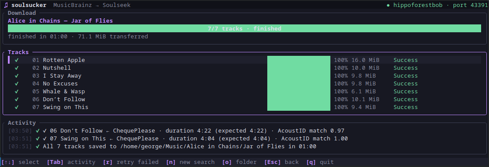

# soulsucker ♫

A terminal album downloader that is actually pleasant to use. Pick an album, EP
or single from **MusicBrainz**, and soulsucker finds matching **FLAC** or **320
kbps MP3** files on **Soulseek**, downloads them, verifies what it got, and
files cleanly numbered tracks into an artist/album library.

Built in Rust with [`ratatui`](https://ratatui.rs/) for the TUI,
[`clap`](https://clap.rs/) for the command line, and
[`soulseek-rs-lib`](https://crates.io/crates/soulseek-rs-lib) for Soulseek.



## Share your music

Soulseek is a peer-to-peer network. It only works because its users share
their own files, and many users block "leechers" — people who download but
share nothing — so sharing is the best way to keep sources available and
queues moving.

soulsucker is a downloader and does not share files itself. To share your
music, use [Nicotine+](https://nicotine-plus.org/) on desktop or
[Seeker](https://github.com/jackBonadies/SeekerAndroid) on Android with the
same Soulseek account. Soulseek allows one session per account, so close
soulsucker while one of those clients is connected. If you want to share and
download at the same time, use Nicotine+ or Seeker for that session.

## Features

soulsucker uses one pooled Soulseek search, local track matching,
duration/fingerprint verification, and automatic retries:

- **New TUI** with a clear screen flow, live per-track progress, an activity
  feed, help everywhere, and adaptive columns.
- **One-time setup.** Soulseek credentials are asked for once, written with
  mode `0600`, and no longer requested at every launch.
- **No per-track search spam.** One `artist album` search feeds every track;
  matching happens locally.
- **Better source selection.** Each remote file is assigned to the track it
  matches best, so similarly named tracks cannot steal each other's sources.
  Matching score comes first, then free slots, peer speed, duration closeness
  and file size. The best 30 sources per track are kept, with at most 10 from
  the same peer. Reported durations are used to reject cross-track matches
  before bytes are spent.
- **One rip per album.** Different masters split tracks at slightly different
  points, so an album stitched together from several peers can lose or repeat
  audio where songs run into each other (The Wall, Abbey Road side two, live
  albums). soulsucker first looks for a peer sharing a file for every needed
  track in one folder (`CD1`/`CD2` subfolders count as one folder), downloads
  and verifies the first track from it alone, and only then takes the rest of
  the album from that same folder. If the check fails, the next full-album peer
  is tried. Sources are mixed only as a last resort.
- **Finds the pressing you actually got.** Pressings of the same album often
  differ in track lengths (a track split a second earlier, a longer fade). If
  a file from the chosen peer is rejected only because its length does not
  match the selected release, soulsucker checks every other pressing of that
  album on MusicBrainz for one with the same tracklist whose lengths fit that
  peer's files. If one fits, it becomes the release: the same file is checked
  again without being downloaded twice, and tracks are tagged with that
  pressing's IDs. Only when no pressing fits is another source tried.
- **Resilient transfers.** Per-attempt staging folders, queue/stall
  watchdogs, next-source fallback, and last-resort passes with more patience.
- **Actual verification.** Finished files are checked against the
  MusicBrainz duration, and optionally against a built-in Chromaprint
  fingerprint via AcoustID.
- **Automatic, consistent tags.** Every downloaded file is tagged
  automatically from the chosen MusicBrainz release — canonical
  album/artist/title/date, track/disc numbers, MusicBrainz IDs, and cover art
  from the iTunes Search API (with the Cover Art Archive as a fallback).
  Existing tags from the peer are replaced, so every album in your library has
  consistent metadata. An optional **disc-prefixed track numbers** setting
  writes tags like `101…113` and `201…213` for players that ignore the disc tag
  (Tesla's USB player, for example).
- **Clean output.** Files are named `01 - Title.flac` (or `1-01 - Title.flac`
  for multi-disc releases; `.mp3` in MP3 mode).
- **FLAC or MP3 320.** Choose lossless FLAC or 320 kbps MP3 in Settings. MP3
  mode prefers a verified 320 kbps MP3 source; when none is available it takes
  a FLAC source and converts it after verification. With loudness
  normalization on, the conversion and the album gain share one encode.
  Encoded MP3s carry an accurate
  LAME gapless header (encoder delay and padding), so gapless players join
  tracks sample-exactly.
- **Album loudness normalization.** An optional EBU R128 album gain brings
  each album to -16 LUFS with a -1.5 dBTP true-peak ceiling, so quiet and loud
  albums sit at a similar level in a car or on a portable player. Every track
  of an album gets the same gain, so the balance between tracks and gapless
  transitions are left exactly as mastered.
- **Skip or force.** Valid existing tracks are skipped by default; `--force`
  downloads them again. A stray/empty file with the right name is validated and
  replaced rather than trusted.
- **In-app updates.** Settings → **Check for updates** asks GitHub for the
  latest release, and when it is newer downloads the matching binary and
  replaces the running executable. Restart soulsucker to use it.

## Requirements

- Rust **1.91+** (edition 2024).
- A Soulseek account.
- FFmpeg **8.x** development libraries to build from source. Prebuilt release
  binaries link FFmpeg and the bundled LAME MP3 encoder statically and need no
  runtime libraries.
- A terminal at least **60×20** cells (the TUI asks for this if it is too small).
- Recommended: a free AcoustID API key from <https://acoustid.org/api> for
  fingerprint verification. Fingerprinting is built in; without a key,
  duration checks still run, but the wrong recording could pass.

On Fedora:

```bash
sudo dnf install ffmpeg ffmpeg-devel
```

On Debian/Ubuntu:

```bash
sudo apt install ffmpeg libavcodec-dev libavformat-dev libavfilter-dev \
  libavutil-dev libswresample-dev
```

## Build / install

```bash
cargo build --release
./target/release/soulsucker
# or
cargo install --path .
```

The normal build links the system FFmpeg shared libraries. For a
self-contained binary that needs no FFmpeg runtime libraries, build FFmpeg
statically:

```bash
cargo build --release --features ffmpeg-static
```

That path needs `git`, `make`, `nasm`, and a C compiler, and takes several
minutes the first time. Release binaries are built this way.

## First run

Run the app with no arguments:

```bash
soulsucker
```

If no credentials are configured, a setup screen asks for:

1. Soulseek username
2. Soulseek password
3. AcoustID API key (free and highly recommended)

> [!IMPORTANT]
> **Please use a free AcoustID key.** Your Soulseek login and AcoustID key are
> checked before setup completes. Without a key, tracks are only checked by
> duration and the wrong recording could be kept. Get a free key at
> <https://acoustid.org/api>.

> [!TIP]
> **Please share your music.** Many Soulseek users block people who only
> download. soulsucker cannot share files itself, so see
> [Share your music](#share-your-music) for the desktop and Android clients to
> use with your account.

They are verified before being saved to the config file shown on screen,
normally:

| Platform | Path |
| --- | --- |
| Linux | `~/.config/soulsucker/config.toml` |
| macOS | `~/Library/Application Support/soulsucker/config.toml` |
| Windows | `%APPDATA%\soulsucker\config.toml` |

`music_dir` defaults to the platform music folder (`~/Music` on most Linux and
macOS setups). Each artist gets a folder there, with album folders inside it:
`<music folder>/<Artist>/<Album>/`.

On Unix the file and its directory are created with owner-only permissions.
The password is stored in plain text, so treat the file like any other secret. Set `SOULSUCKER_CONFIG` or use `--config FILE` to
put it somewhere else.

You can change everything later in **Settings (`F2`)**. Credential-related CLI
flags (`--username`, `--password`, `--acoustid-key`) are also saved, so they
only have to be supplied once.

## Usage

```bash
# Open the TUI on the search screen
soulsucker

# Prefill the search
soulsucker "Metallica" "Ride the Lightning"
soulsucker -a "Metallica" -A "Ride the Lightning"

# Save a different source folder for this run
soulsucker -o ~/Music

# Pick the recommended release and start immediately
soulsucker -a "Radiohead" -A "In Rainbows" --yes

# Re-download tracks that already exist
soulsucker -a "Radiohead" -A "In Rainbows" --force

# Re-open the credential screen
soulsucker --setup

# Disable fingerprinting for this run
soulsucker --no-fingerprint
```

### What happens when you press Download

1. MusicBrainz returns matching **albums, EPs, live albums, live EPs, singles**
   and other release groups, ranked with exact matches and studio albums first.
2. You pick one. soulsucker looks up its pressings and shows the recommended
   release — remastered pressings first, then official standard editions — with
   **Continue** selected by default, or **Choose another release** to browse
   every pressing. Continue loads the full audio tracklist, including
   multi-disc releases and skipping DVD/Blu-ray mediums. Video-only releases
   (a concert DVD, a Blu-ray) are left out of the release list, since they have
   no audio to download.
3. The destination is created at `<music folder>/<Artist>/<Album>/`.
   Releases MusicBrainz marks as **Single** skip the album folder and are saved
   as loose files directly in `<music folder>/<Artist>/`, alongside the album
   folders.
4. One Soulseek search for `"artist album"` runs for the configured timeout.
5. In FLAC mode, every FLAC result is matched against every track locally. In
   MP3 320 mode, MP3 results identified as 320 kbps are preferred and FLAC is
   kept as a fallback. Junk (`sample`, `preview`, `snippet`), the wrong format,
   tiny files and wildly wrong durations are ignored.
6. If peers share the whole album in one folder, the best one is checked
   first: only the first needed track is downloaded from it and verified (step
   7). When it passes, every other track comes from that same folder; while
   that peer is busy sending other tracks, tracks waiting in its queue keep
   waiting instead of timing out. When the check fails, the next full-album
   peer is checked the same way. Only when no full-album copy passes are
   tracks taken from the best source for each track individually. Tracks
   download one at a time by default (`max_concurrent`). Each attempt gets its
   own hidden staging folder inside the destination folder, so partial files
   can never be mistaken for finished ones.

   Soulseek peers only serve one transfer at a time per username, so when
   `max_concurrent` is above 1 soulsucker also logs in with extra accounts: your
   username with `1`, `2`, `3`… appended and the same password (for example
   `hippoforestbob`, `hippoforestbob1`, `hippoforestbob2` for three parallel
   downloads). Soulseek creates an account the first time it sees new
   credentials. Each live download runs on its own account; if an extra login
   is refused or fails, downloads simply use fewer accounts.

   Only live transfers use those download slots. Checking, loudness
   measurement and conversion of finished files run alongside the next
   download, limited separately by `max_processing` (default 3).
7. When a transfer completes, its duration is checked. With an AcoustID key,
   the built-in Chromaprint fingerprint is also checked: the expected
   MusicBrainz recording must appear in AcoustID's **top-scoring cluster**.
   MP3 sources are also checked for a genuine 320 kbps bitrate.
8. If a file from the chosen full-album peer fails only on length, the other
   pressings in the release group are fetched from MusicBrainz and compared
   with that peer's measured and reported track lengths (same discs,
   positions and titles; every known length within the length tolerance). A
   fitting pressing replaces the selected release — expected lengths,
   MusicBrainz IDs and release date — and the held file is verified again;
   tracks already saved are retagged. An album switches pressing at most
   twice.
   A wrong version, a stall, a queue timeout or a rejected transfer moves on
   to the next-best source (for a track from the chosen full-album peer, the
   other peers' copies of that track). If every source fails, the list is retried in
   last-resort passes with longer patience.
9. Only after verification, an accepted file is converted and/or normalized.
   In MP3 mode a FLAC source becomes a 320 kbps MP3 here. With loudness
   normalization on, each verified track is measured and held until every
   track of the album is in; then one album gain is applied to all of them,
   in the same encode as any MP3 conversion.
10. Accepted files are renamed, then retagged from the chosen MusicBrainz
    release: title, track artist, album artist, album, release date,
    track/disc numbers, and MusicBrainz IDs. Cover art is fetched from the
    iTunes Search API first, with the Cover Art Archive as a fallback.
    Embedded art from the source is replaced, so a file cannot keep a cover
    from a different edition. If **disc-prefixed track numbers** is enabled,
    multi-disc track tags become `101…113`, `201…213`, and so on.

## Keys

Global keys work everywhere (while a text field is focused, printable keys
edit the field; `F1` still opens help):

| Key | Action |
| --- | --- |
| `F1` / `?` | Help for the current screen |
| `F2` | Settings |
| `F5` | Reconnect to Soulseek |
| `Ctrl+Q` / `Ctrl+C` | Quit (asks first if downloads are running) |
| `Esc` | Back / cancel the current edit |

Settings is unavailable while a download is running or a MusicBrainz request
is in flight; `Esc` cancels the request so you can open it.

### Search

| Key | Action |
| --- | --- |
| `Tab` / `Shift+Tab` | Move between artist, album and results |
| `Enter` | Search (from album) / choose an album, EP or release |
| `↑` `↓` `PgUp` `PgDn` `Home` `End` | Choose an album, EP or release |
| `Esc` | Back to the previous search step |
| `/` or `e` | Edit the album field |
| `r` | Run the search again |
| `s` | Settings |

### Tracklist

| Key | Action |
| --- | --- |
| `↑` `↓` `PgUp` `PgDn` `Home` `End` | Scroll |
| `d` / `Enter` | Start downloading |
| `f` | Toggle fingerprint verification for this run |
| `b` / `Esc` | Back to the search results |
| `s` | Settings |

### Download

| Key | Action |
| --- | --- |
| `↑` `↓` `PgUp` `PgDn` `Home` `End` | Select a track |
| `Tab` | Switch focus between tracks and the activity log |
| `x` | Cancel the selected track |
| `r` | Retry failed tracks |
| `n` | Cancel and start a new search |
| `o` | Open the album folder in the file manager |
| `Esc` | Back to search once finished (or cancel a pending login) |
| `q` | Quit |

### Settings

| Key | Action |
| --- | --- |
| `←` `→` / `Tab` | Switch tabs |
| `↑` `↓` `Home` `End` | Select a field in the current tab |
| `Enter` | Edit / toggle / cycle / run action |
| `Ctrl+S` | Save and return |
| `Esc` | Discard and return |

Settings is split into four tabs:

- **Account** — Soulseek credentials, AcoustID key, fingerprint checking and
  score.
- **Library** — music folder, FLAC/MP3 320 output, Tesla-friendly tags and
  loudness normalization.
- **Downloading** — parallel downloads, parallel processing (checking and
  converting), search/queue/stall timeouts, length tolerance, retry passes and
  sources per track.
- **Advanced** — listener port, MusicBrainz result count and the update check.

**Check for updates** compares the running version with the latest public
GitHub release. If a newer release exists, it downloads the matching raw
binary, checks the executable header, and replaces the running file atomically.
The current process keeps running the old version until you restart. Automatic
updates work with the prebuilt Linux x86_64, macOS ARM64/Intel, and Windows
x86_64 releases.

## Configuration

The config is TOML. A representative file:

```toml
username = "your-soulseek-name"
password = "your-password"
acoustid_key = "your-acoustid-key"

music_dir = "/home/you/Music"
audio_quality = "flac"
max_concurrent = 1
max_processing = 3
search_timeout_secs = 20
queue_timeout_secs = 120
stall_timeout_secs = 15
length_tolerance_secs = 5.0
fingerprint = true
fingerprint_min_score = 0.8
last_resort_rounds = 2
last_resort_stall_timeout_secs = 60
candidates_per_track = 30
listen_port = 0
mb_limit = 25
disc_prefix_track_numbers = false
album_artist_for_tracks = false
normalize_loudness = false
```

`listen_port = 0` asks the OS for a free port, which is friendlier than a
fixed port when several apps use the network. If you need port forwarding,
set a specific port and forward it on your router.

`audio_quality = "flac"` keeps lossless output. Set it to `"mp3_320"` to write
320 kbps MP3 files instead. MP3 mode prefers a Soulseek source whose reported
bitrate or size/duration identifies a 320 kbps MP3; every downloaded MP3 is
also checked after transfer so a mislabeled 128 kbps file is rejected. If no
320 kbps MP3 source is available, soulsucker downloads a FLAC and converts it
after the duration and AcoustID checks. MP3 sources are kept untouched when
normalization is off; with normalization on they are decoded and re-encoded at
320 kbps to apply the album gain (unless the gain rounds to 0 dB). If
conversion fails for a
FLAC-to-MP3 track, that source is rejected and the next source is tried.

`disc_prefix_track_numbers = false` keeps standard per-disc track tags. Set it
to `true` for players that ignore the disc tag (notably Tesla's USB player):
multi-disc tracks are then tagged `101…113`, `201…213`, and so on. Album names
and filenames stay unchanged. The setting applies when tags are written, so
enable it and rerun with `--force` to retag an existing download.

`album_artist_for_tracks = false` keeps each MusicBrainz track credit in
`ARTIST`. Set it to `true` for players that group by track artist (notably
Tesla's USB player): every track gets the album artist in `ARTIST`, while the
original credit is preserved in `ARTISTS`. Guest and live tracks then stay
inside the album instead of creating a second artist entry. This also applies
when tags are written, so enable it and rerun with `--force` to retag an
existing download.

`normalize_loudness = true` applies an EBU R128 **album gain**. Each verified
track's integrated loudness and true peak are measured with FFmpeg's `loudnorm`
filter, and the track waits in staging ("verified · waiting for the rest of
the album") until every track has finished or given up. The album loudness is
the duration-weighted energy mean of the tracks, and one gain brings it to
**-16 LUFS**, limited so the loudest true peak on the album stays at or below
**-1.5 dBTP**. That same static gain is applied to every track; there is no
per-track adjustment or limiter, so tracks keep their mastered balance and
gapless transitions stay seamless. A quiet album with one very peaky track can
therefore end up a little below -16 LUFS rather than being squashed.

FLAC output is re-encoded losslessly. In MP3 320 mode the album gain and any
FLAC-to-MP3 conversion happen in one encode. The processed file replaces the
original only after the entire encode succeeds. If processing fails, an
already-correct source is kept and saved at its original level; a FLAC source
that still needs MP3 conversion is rejected so another source can be tried. A
track retried later reuses the album's gain. Tracks already on disk are skipped
and not part of the measurement, so rerun with `--force` to normalize a whole
existing album consistently.

## CLI options

Run `soulsucker --help` for the full list. Useful ones:

| Flag | Meaning |
| --- | --- |
| `-a`, `-A` | Artist / album |
| `-o`, `--output` | Root music folder for this run |
| `--yes` | Auto-pick the recommended album, release and download |
| `--force` | Re-download existing files |
| `--no-fingerprint` | Duration checks only for this run |
| `--search-timeout` | Seconds to collect Soulseek results |
| `--queue-timeout` | Seconds to wait in a peer queue |
| `--stall-timeout` | Seconds without progress before switching source |
| `--max-concurrent` | Parallel track downloads (each uses its own extra Soulseek account) |
| `--max-processing` | Tracks checked, measured or converted at once |
| `--length-tolerance` | Allowed MusicBrainz duration difference |
| `--fingerprint-min-score` | Minimum AcoustID match score |
| `--last-resort-rounds` | Extra passes over exhausted sources |
| `--last-resort-stall-timeout` | Patience during those passes |
| `--candidates` | Sources tried per track |
| `--port` | Soulseek listener port |
| `--limit` | MusicBrainz album/EP matches to fetch |
| `--config` | Alternate config file |
| `--setup` | Force the credential screen |

Credential flags (`--username`, `--password`, `--acoustid-key`) are written to
the config file. Other flags override the stored settings for the current run
only; use Settings (`F2`) to make a value the new saved default. `--verbose`
prints the Soulseek library's raw logs after the TUI exits; those lines can
contain peer-supplied text, so treat them as untrusted.

## Troubleshooting

- **Login rejected.** Open Settings (`F2`) and check the username/password.
  If another client is logged in with the same account, the server will
  displace one of them.
- **MusicBrainz is busy.** The app retries `429/502/503/504` responses three
  times with a backoff. If it still fails, wait a moment and press `r`.
- **No matching sources.** Soulseek is peer-to-peer: availability changes by
  the minute. Try a longer search timeout, another pressing/edition, set
  **Audio quality** to FLAC, or search again later.
- **A track keeps failing.** Open the activity log (`Tab`) to see whether it
  was a queue timeout, a stall, a duration mismatch or an AcoustID mismatch.
- **Fingerprinting does not run.** Add an AcoustID key in Settings.
  Chromaprint is built into the binary; without a key, duration checks still
  reject wrong-length versions.
- **Stale partial files.** They live in the destination folder's hidden
  `.soulsucker-staging` directory and are cleaned up at the start of the next
  download for that release. Quitting also tries to remove them.
- **Two track 1s on a multi-disc album (Tesla).** Tesla's USB player ignores
  the disc tag and sorts only by track number. Enable Settings →
  **Disc-prefixed tracks** (or `disc_prefix_track_numbers = true`) and rerun
  with `--force` to retag; tracks then appear as `101…`, `201…`.
- **The same album appears under a second artist (Tesla).** A guest or live
  track carries a different MusicBrainz `ARTIST` credit. Enable Settings →
  **Album artist on tracks** (or `album_artist_for_tracks = true`) and rerun
  with `--force`; every track is then grouped under the album artist, with the
  original credit kept in `ARTISTS`.
- **Update failed with a permission error.** soulsucker cannot replace a binary
  in a read-only or system-owned directory. Move it somewhere writable, install
  it under your home directory, or download the release asset manually.
- **Firewalled peer.** Soulseek can broker connections, but two peers both
  behind strict NAT may not be able to transfer. The app simply tries another
  source.

## Notes

Soulseek is peer-to-peer. Downloads depend on who is online and sharing, and
peers set their own queues and speeds. The Soulseek server allows one session
per account, so do not run two instances with the same login. This client only
downloads; it does not share folders. Be excellent: respect artists and other
users, and only download material you have the rights to.

This project is not affiliated with Soulseek, MusicBrainz or AcoustID.

MP3 encoding uses the bundled [LAME](https://lame.sourceforge.io/) library,
which is licensed under the LGPL. The project source is available in this
repository.
